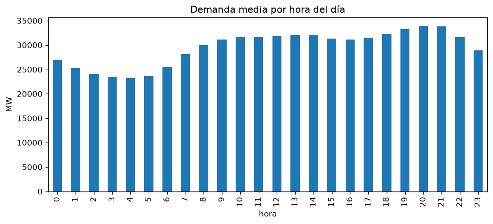
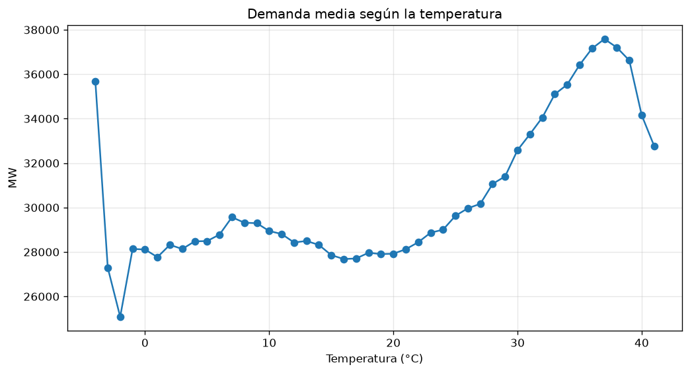
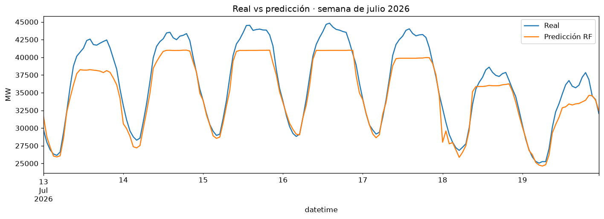

# Predicción de la demanda eléctrica en España

Este es mi primer proyecto de machine learning. Quería trabajar con datos
reales del sector energético, así que construí un modelo que predice la demanda
eléctrica horaria de España con un día de antelación, usando la hora, el
calendario y la temperatura.

El modelo final (Random Forest) se equivoca de media un 2,87%, un 35% menos que
la predicción más simple posible: suponer que se consumirá lo mismo que hace
una semana.

## Por qué este problema

Red Eléctrica y las comercializadoras necesitan saber cuánta energía se va a
consumir para planificar la generación. Si la previsión se queda corta, hay que
arrancar centrales de urgencia; si se pasa, sobra energía. En los dos casos
cuesta dinero. Me interesaba entender qué factores mueven la demanda y hasta
dónde se puede predecir.

## Los datos

En lugar de usar un dataset ya preparado, decidí construirlo yo a partir de
dos fuentes públicas:

- **Demanda eléctrica:** API de Red Eléctrica de España (REE), con datos cada
  5 minutos desde enero de 2024 hasta octubre de 2026.
- **Temperatura:** API de Open-Meteo, datos horarios de Madrid.

Después de limpiarlos y unirlos, el dataset final tiene 24.783 horas.

Fuentes: datos de demanda de [Red Eléctrica de España](https://www.ree.es/es/apidatos);
datos meteorológicos de [Open-Meteo](https://open-meteo.com/) (CC BY 4.0).

## Cómo lo hice

**Descarga.** La API de REE solo deja pedir unos 7 días por petición, así que
tuve que descargar los datos semana a semana, unas 150 peticiones en total.

**Limpieza.** Pasé los datos de 5 minutos a horas. El cambio de hora me dio
bastante guerra: en marzo hay una hora que no existe y en octubre una que se
repite. Lo resolví trabajando en UTC y convirtiendo a hora española al final.
También encontré 40 horas sin datos (un 0,16%). Los huecos cortos los rellené
interpolando y los largos con el valor de la misma hora de la semana anterior,
para no perder la forma de la curva diaria. Excluí además la semana del apagón
del 28 de abril de 2025, porque es un evento imposible de predecir.

**Análisis exploratorio.** Antes de modelar, estudié cómo cambia la demanda
según la hora, el día, el mes y la temperatura.

**Variables.** Hora, día de la semana, mes, fin de semana, festivos,
temperatura, y la demanda de hace 24 horas y de hace una semana.

**Modelos.** Empecé con dos predicciones de referencia (baselines) y después
probé una regresión lineal y un Random Forest.

## Lo que encontré en los datos



- El consumo es mínimo hacia las 4 de la madrugada y máximo a las 20–21 h,
  algo muy ligado a los horarios españoles.
- Los fines de semana se consume menos.
- Hay dos picos al año: invierno por la calefacción y verano por el aire
  acondicionado.
- A mediodía la demanda baja un poco. Creo que parte de la explicación es el
  autoconsumo solar: las casas y empresas con placas tiran menos de la red en
  las horas de más sol.



Lo que más me sorprendió fue la temperatura. La relación con la demanda tiene
forma de U: se consume más cuando hace mucho frío y cuando hace mucho calor.
Por eso la correlación es de solo 0,30, aunque la relación es fuerte. Fue una
buena lección: una correlación baja no significa que no haya relación, solo
que no es una línea recta.

En esta gráfica, con datos horarios, el lado del frío apenas se aprecia: en
Madrid las horas más frías son de noche, cuando la demanda ya es baja por sí
misma. Al usar medias diarias de los días laborables, la U se ve con claridad:
unos 32.000 MW con 2–5 °C, un mínimo de unos 28.000 MW entre 14 y 17 °C, y
unos 35.000 MW con 30 °C.

## Cómo separé los datos

En series temporales no se pueden repartir los datos al azar entre
entrenamiento y test, porque el modelo acabaría usando el futuro para predecir
el pasado y los resultados serían engañosos. Por eso los separé por fecha:

- **Entrenamiento:** enero 2024 – octubre 2025
- **Test:** noviembre 2025 – octubre 2026 (un año completo)

Como el objetivo es predecir con un día de antelación, el modelo solo usa la
demanda de hace 24 horas o más.

## Resultados

| Modelo | MAE (MW) | MAPE (%) | RMSE (MW) |
|--------|---------:|---------:|----------:|
| Baseline: día anterior | 1.928 | 6,21 | 2.894 |
| Baseline: semana anterior | 1.392 | 4,42 | 2.074 |
| Regresión lineal | 1.112 | 3,54 | 1.522 |
| Random Forest (8 variables) | 943 | 2,90 | 1.383 |
| **Random Forest (11 variables)** | **933** | **2,87** | **1.356** |



El Random Forest es el que mejor funciona porque capta relaciones que no son
rectas, como la curva del día o la U de la temperatura. La regresión lineal
mejora los baselines sobre todo gracias a la demanda de días anteriores.

### Los festivos, el punto débil

Al analizar los errores vi que el modelo fallaba sobre todo en diciembre, y
mirando día a día descubrí por qué: no solo fallaba en los festivos, sino
también en los días siguientes, porque usaba como referencia la demanda baja
del festivo.

Añadí tres variables (si ayer fue festivo, si hace una semana fue festivo y si
es Nochebuena o Nochevieja). El error global apenas cambió (2,90% → 2,87%),
pero sí mejoró en los días concretos que buscaba, como el 9 de diciembre
(10,6% → 8,2%) o el 26 (6,8% → 4,6%). En otros no mejoró: Nochebuena sigue
rondando el 11% de error, porque en el histórico solo hay una y el modelo no
puede aprender de un único ejemplo. Y el 7 de diciembre empeoró, porque el
festivo anterior cayó en sábado y el modelo corrigió de más.

## Limitaciones

- Solo uso la temperatura de Madrid, no la de toda España.
- Dos años de datos se quedan cortos para eventos que pasan una vez al año.
- En la vida real no se conoce la temperatura de mañana, solo su previsión.
  Yo he usado la temperatura real, así que los resultados son algo optimistas.

## Qué me gustaría probar después

- Usar una media de temperatura de varias ciudades.
- Probar otros modelos como LightGBM.
- Comparar mis predicciones con la previsión oficial que publica Red Eléctrica.

## Lo que aprendí

Más allá del modelo, la mayor parte del trabajo estuvo en conseguir y preparar
los datos. Algunos problemas que tuve que resolver:

- La API de REE devolvía un error que decía "datos no disponibles", pero en
  realidad faltaba un parámetro obligatorio.
- El cambio de hora, que me obligó a entender bien cómo funcionan las zonas
  horarias.
- Una unión de tablas que devolvía todo vacío porque las fechas no estaban en
  el formato correcto.
- Errores por ejecutar las celdas del notebook en distinto orden. Ahora
  siempre compruebo que todo funciona ejecutándolo de principio a fin.

## Estructura del proyecto

```
prediccion-consumo-energetico/
├── data/
│   ├── raw/                 # datos originales descargados de la API de REE
│   └── processed/           # datos limpios y dataset final
├── notebooks/
│   ├── 01_descarga_datos.ipynb
│   ├── 02_limpieza.ipynb
│   ├── 03_eda.ipynb
│   └── 04_modelado.ipynb
├── reports/
│   ├── figures/             # gráficas usadas en este README
│   └── resultados_modelos.csv
└── requirements.txt
```

## Cómo ejecutarlo

```bash
git clone https://github.com/ceciliamipit-max/prediccion-consumo-energetico.git
cd prediccion-consumo-energetico
python3 -m venv .venv
source .venv/bin/activate
pip install -r requirements.txt
```

Los notebooks se ejecutan en orden. Los datos ya están incluidos, así que se
puede empezar directamente por el notebook 2. El notebook 1 vuelve a descargar
los datos desde la API.

---

Cecilia · [LinkedIn](https://www.linkedin.com/in/cecilia-miralles-pitarch-7817842a6) · [GitHub](https://github.com/ceciliamipit-max)
